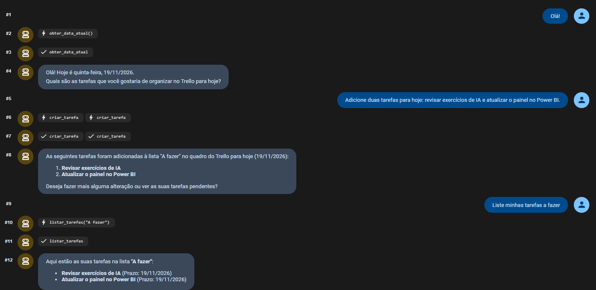
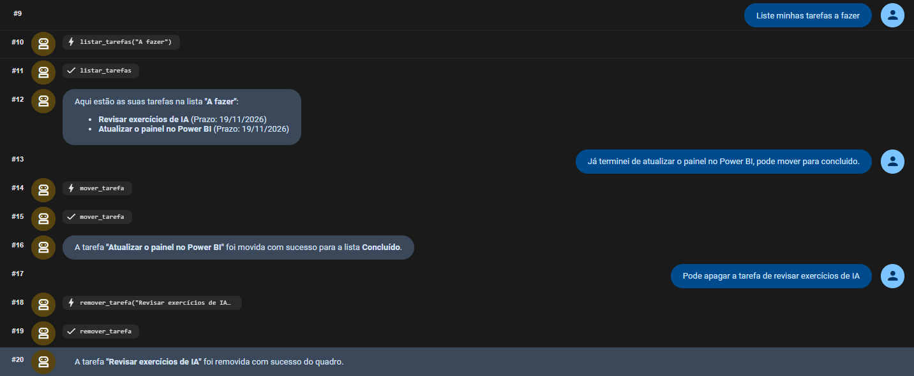
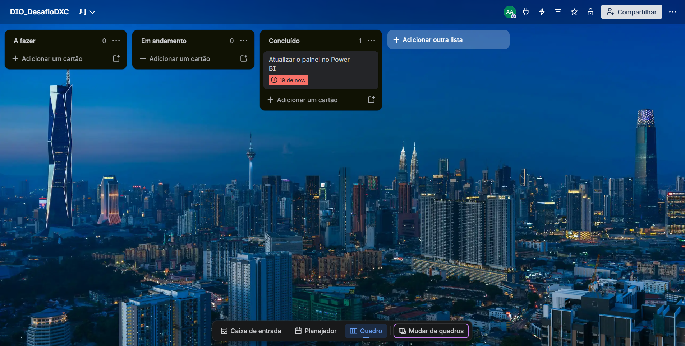

# Agente de IA para Gestão de Tarefas no Trello (Google ADK + Gemini)

Agente conversacional em Python desenvolvido com o **Google Agent Development Kit (ADK)** e o modelo **Gemini** para organizar tarefas diárias diretamente em quadros do **Trello** por meio de linguagem natural. Projeto entregue para o desafio de Agentes de IA da **DIO & Bradesco**.

## Funcionalidades e Ferramentas (Tools)

Cada ação no Trello foi implementada como uma função Python registrada como ferramenta no `root_agent`:

| Ferramenta | Função |
| :--- | :--- |
| `obter_data_atual` | Retorna a data e o dia da semana no fuso de Brasília (`UTC-3`) para iniciar a conversa e converter prazos relativos ("hoje", "amanhã"). |
| `listar_quadros` | Lista os quadros abertos da conta no Trello, permitindo alternar além do quadro padrão. |
| `criar_tarefa` | Cria um card na lista **A fazer** com título, descrição e data de vencimento opcional (`YYYY-MM-DD`). |
| `listar_tarefas` | Exibe os cards do quadro, podendo filtrar por status (**A fazer**, **Em andamento**, **Concluído**). |
| `mover_tarefa` | Move um card existente entre as listas conforme o relato do usuário. |
| `remover_tarefa` | Exclui permanentemente um card do quadro. |

## Melhorias Implementadas sobre o Projeto Base

Além da reprodução funcional do desafio, o código foi refatorado com foco em resiliência e boas práticas:

1. **Correção de data e timezone:** os prazos enviados ao `py-trello` são validados e formatados em ISO-8601 às `15:00:00.000Z` (`12:00 BRT`), eliminando o bug em que o card chegava ao Trello com um dia a menos.
2. **Normalização de texto e acentos:** a função `normalizar_texto` (via `unicodedata`) remove acentos, espaços extras e diferenças de caixa, aceitando comandos como `"concluido"` ou `"A FAZER"` sem gerar status inválido.
3. **Ferramenta `remover_tarefa`:** implementada para fechar o ciclo completo de gerenciamento (CRUD) previsto nas instruções do agente.
4. **Tratamento de erros padronizado:** todas as ferramentas utilizam blocos `try/except`, evitando travamentos da conversa em caso de card inexistente, formato de data inválido ou falha de rede/API.
5. **Conexão unificada com o Trello (DRY):** a validação de variáveis de ambiente e a instanciação do `TrelloClient` foram centralizadas em `obter_cliente_trello()`.
6. **Suporte a múltiplos quadros:** todas as operações aceitam o parâmetro opcional `nome_quadro` (com padrão configurável em `QUADRO_PADRAO`), combinadas à ferramenta `listar_quadros`.

## Estrutura do Projeto

```text
agente-tarefas-trello-adk/
├── agente_trello/
│   ├── __init__.py          # Expõe o módulo agent para descoberta do ADK
│   ├── agent.py             # Ferramentas py-trello e definição do root_agent
│   └── .env                 # Credenciais locais (ignorado pelo Git)
├── docs/                    # Prints de validação do funcionamento
├── .env.exemplo             # Modelo de variáveis de ambiente
├── .gitignore
├── requirements.txt
└── README.md
```

## Como Configurar e Executar

### Pré-requisitos
* Python **3.10 ou superior**
* Conta no [Trello](https://trello.com/)
* Chave gratuita da API do Gemini no [Google AI Studio](https://aistudio.google.com/apikey)

### 1. Configurar o Trello
1. Crie um quadro no Trello (neste projeto foi utilizado o nome **`DIO_DesafioDXC`**; caso use outro nome, ajuste a constante `QUADRO_PADRAO` em `agente_trello/agent.py`) com três listas: **`A fazer`**, **`Em andamento`** e **`Concluído`**.
2. Acesse o painel de desenvolvedor em `[https://trello.com/apps/admin](https://trello.com/apps/admin)` e clique em **Novo** para criar um aplicativo.
3. No menu lateral esquerdo do aplicativo criado, abra **Autorização → Autenticação do Trello** e clique em **Gerar uma nova chave de API**.
4. Copie a **Chave de API** (`TRELLO_API_KEY`), o **Segredo** (`TRELLO_API_SECRET`) e clique no link **Token** (ou acesse `[https://trello.com/1/authorize?expiration=never&name=AgenteADK&scope=read,write&response_type=token&key=SUA_API_KEY](https://trello.com/1/authorize?expiration=never&name=AgenteADK&scope=read,write&response_type=token&key=SUA_API_KEY)`) para autorizar e gerar o `TRELLO_TOKEN`.

### 2. Preparar o ambiente local
```bash
git clone https://github.com/artuart-little/dio-dxc-desafio-agente-trello.git
cd agente-tarefas-trello-adk

python -m venv .venv
# Windows (PowerShell):
.\.venv\Scripts\Activate.ps1
# Linux/macOS:
# source .venv/bin/activate

pip install -r requirements.txt
```

### 3. Configurar as credenciais
Copie `.env.exemplo` para `agente_trello/.env` e preencha suas chaves:

```env
GOOGLE_GENAI_USE_VERTEXAI=FALSE
GOOGLE_API_KEY=sua_chave_do_google_ai_studio_aqui

TRELLO_API_KEY=sua_api_key_trello_aqui
TRELLO_API_SECRET=seu_api_secret_trello_aqui
TRELLO_TOKEN=seu_token_trello_aqui
```

### 4. Executar o agente
A partir da **pasta raiz** do projeto (com o `.venv` ativo), inicie a interface do Google ADK:

```bash
adk web
```

Acesse `http://localhost:8000`, selecione **`agente_trello`** no menu superior esquerdo e inicie a conversa.

> **Nota sobre o modelo:** foi configurado o alias `gemini-flash-lite-latest` para garantir baixa latência e estabilidade no tier gratuito do Google AI Studio.

## Como Foi Testado e Evidências

O fluxo completo foi validado em sessão real no `adk web` acompanhado em tempo real no quadro do Trello:

1. Saudação inicial com chamada automática de `obter_data_atual()` retornando a data correta (`19/11/2026`).
2. Criação simultânea de duas tarefas para a data atual via `criar_tarefa` e conferência por filtro com `listar_tarefas("A fazer")`.
3. Movimentação de uma tarefa enviando o status `"concluido"` **sem acento** via `mover_tarefa` e exclusão da segunda tarefa via `remover_tarefa`.
4. Verificação no Trello confirmando o card restante na lista **Concluído** com a data exata (`19 de nov.`) e a remoção efetiva do card apagado.

### Conversa no `adk web` (criação e listagem)


### Conversa no `adk web` (movimentação sem acento e remoção)


### Resultado refletido no quadro do Trello
